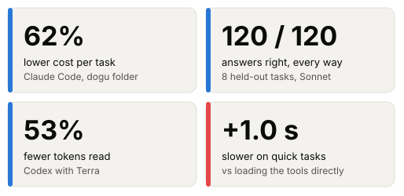
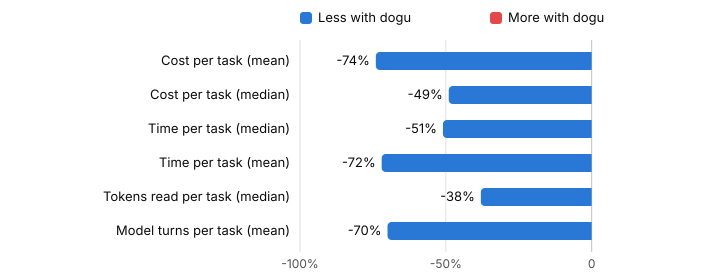
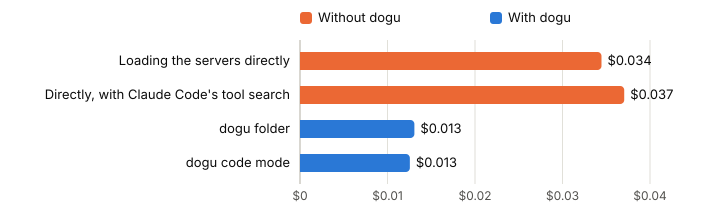
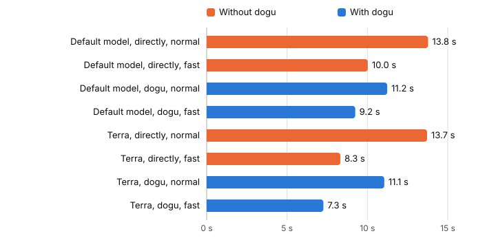

# dogu benchmarks, in plain words

AI coding agents like Claude Code, Codex and pi can use extra tools, such as "search GitHub" or "read this project's docs". The usual way to give them those tools makes the agent read a long description of every tool before every task, even tools it never uses. That reading costs money and time.

dogu gives the agent the same tools in a lighter way. We tested whether that is really cheaper and faster, with real agents doing real tasks, and checked every answer: on a public benchmark someone else wrote, on our own tasks, and against the other code modes we could run.

## TL;DR

**On MCPMark, a public benchmark we did not write, dogu's code mode passed about as many tasks (101 of 120 against 102) for about a quarter of the cost ($0.052 a task against $0.199) in half the time (11.8 s against 24.3 s, median).** It was cheaper on 36 of the 40 tasks and faster on 34.

| Test | Who wrote the tasks | Size | Answers right, dogu vs other | Cost per task | Time per task (median) |
|---|---|---|---|---|---|
| [**MCPMark** filesystem tasks](#1-a-public-benchmark-mcpmark), dogu 0.7.5 vs loading the server directly | eval-sys (public) | 40 tasks × 3 runs | 101 vs 102 of 120 | **$0.052** vs $0.199 (**74% less**) | **11.8 s** vs 24.3 s (**2.1× faster**) |
| [Our held-out tasks](#2-what-a-task-costs), dogu 0.7.0 vs loading the servers directly | us, saved before any run | 7 tasks × 3 runs | 21 vs 21 of 21 | **$0.011** vs $0.036 (**68% less**) | **3.7 s** vs 3.9 s (5% faster) |
| The same, vs Claude Code's own tool search | us | 7 × 3 | 21 vs 21 of 21 | **$0.011** vs $0.038 (**70% less**) | **3.7 s** vs 6.0 s (1.6× faster) |
| [vs UTCP code-mode](#utcp-code-mode), the most-starred standalone code mode | us | 11 × 3 | 30 vs 31 of 33 | **$0.012** vs $0.022 (**48% less**) | **2.8 s** vs 4.3 s (1.5× faster) |
| [vs pi's own code mode](#pi), inside pi with gpt-6.2-sol | us | 8 × 3 | 24 vs 24 of 24 | **$0.023** vs $0.034 (**31% less**) | **7.0 s** vs 11.0 s (1.6× faster) |
| [vs Codex's own code mode](#4-other-agents), dogu's folder | us | 8 × 2 | 16 vs 16 of 16 | **48k** vs 65k tokens (**26% fewer**)* | **9.0 s** vs 12.2 s (1.4× faster) |

\* Codex on a ChatGPT plan reports tokens, not a price.

**Where it does not win** (more in [section 7](#7-where-dogu-does-not-win)): on MCPMark's easy tasks it passed 2 fewer (25 against 27 of 30), and it lost one hard task all 3 times that loading directly won all 3 times. dogu's *folder* is still a little slower than loading directly on average in an open Claude Code session.



Every number on this page comes from the files in [`bench/results/`](bench/results/), the charts are drawn from those files by code, and you can [run the tests yourself](#run-it-yourself). The research behind each version, including the experiments that lost, is in [docs/research/code-mode.md](docs/research/code-mode.md).

## The test setup

| | |
|---|---|
| **Machine** | Mac mini, Apple M4, 16 GB, macOS 26.5.1, on a home internet connection (the hosted tool servers are on the internet). |
| **Agents** | Claude Code (2.1.330 for the MCPMark run), Codex 0.171, pi. All runs on 2026-11-22. |
| **Model** | Claude Sonnet unless a section says otherwise. |
| **What a run is** | One task, one fresh conversation, run headless (`claude -p`). Each task ran 2 or 3 times in each setup, and the setups took turns going first. |
| **What we measure** | Whether the answer was right (checked by code, never by an AI); the price the agent reports, at API list prices; tokens read; model turns; time as Claude Code counts it; and the whole run including start-up. |
| **What we leave out** | One-off setup (`dogu sync`, under a minute once); your own time; variation in the network and the AI provider's speed, which we did not control (runs were spread over the day and repeated). |

## A few words first

| Word | What it means here |
|---|---|
| **Agent** | An AI that does tasks by itself, such as Claude Code, Codex or pi. |
| **Tool** | Something the agent can use, like "search GitHub repositories". Tools come from **MCP servers**. We used GitHub's own server, Context7 (library docs), DeepWiki (docs about code on GitHub) and a small local "memory" server. |
| **Tokens** | Pieces of text the AI reads. More tokens means more to read: more cost and usually more time. |
| **Cost** | What the agent's AI company charges for one task, in US dollars, at API prices. |
| **Loading the servers directly** | The usual way: the agent gets every tool's full description up front. |
| **dogu folder** | Each tool becomes a small command in a folder, and the agent gets one short line per tool. |
| **dogu code mode** | The agent writes a short program that calls the tools it needs. |


The stacks of pages are drawn to scale: one page for every 2,500 tokens the agent reads before it starts (Claude Code with Sonnet, median).

## 1. A public benchmark: MCPMark

Our own tasks could, in principle, suit dogu. So we also ran a benchmark someone else wrote: [MCPMark](https://github.com/eval-sys/mcpmark) (Apache-2.0, from eval-sys; [paper](https://arxiv.org/abs/2509.24002)). We used its 40 filesystem tasks: 10 easy and 30 standard, such as "find every paper by each author and sort them into folders", "work out from 11 versions of a contract who first proposed each final clause", or "write the requirements file for this codebase". Each task comes with its starting files and its own checker, a Python script with fixed expected values. **MCPMark's checkers decide what passed, not us and not an AI.**

**What this measures:** dogu's code mode against the usual way, loading the filesystem server directly, in Claude Code with Sonnet, dogu 0.7.5, 3 runs of each task in each setup. Claude Code's own file and shell tools were off in both, so all work went through the server. **What it leaves out:** dogu's folder (it needs a shell, and a shell can reach the files without the server), and other agents. It is one server with 14 tools, so the up-front tool list is small either way: the saving here comes from the agent needing fewer turns, not from a shorter list.



| 40 tasks × 3 runs | Passed | Cost per task (mean) | Cost (median) | Time (median) | Half the runs took | Slowest run | Model turns (mean) | Tokens read (median) |
|---|---|---|---|---|---|---|---|---|
| Loading the server directly | 102 of 120 | $0.199 | $0.090 | 24.3 s | 11.6 to 57.0 s | 341 s | 13.8 | 51.9k |
| **dogu code mode** | 101 of 120 | **$0.052** | **$0.046** | **11.8 s** | **7.8 to 16.3 s** | **46 s** | **4.2** | **31.9k** |

The whole benchmark, 120 runs, cost **$23.70** loading the server directly and **$6.18** with dogu.

| By difficulty | Passed | Cost per task (mean) | Time (median) |
|---|---|---|---|
| Easy (10 tasks): loading directly | 27 of 30 | $0.056 | 11.5 s |
| Easy: **dogu code mode** | 25 of 30 | **$0.036** (35% less) | **6.1 s** (1.9× faster) |
| Standard (30 tasks): loading directly | 75 of 90 | $0.248 | 32.6 s |
| Standard: **dogu code mode** | **76 of 90** | **$0.057** (77% less) | **12.9 s** (2.5× faster) |

**What this means:** the harder the task, the bigger the gap. On a standard task the agent loading the server directly averaged 16.6 turns with one tool call in each (15.6 calls); with dogu it wrote short programs that worked through many files at once, in 4.5 turns. On one task (sorting papers into author folders), loading directly failed all 3 runs: they took 44 turns and 84 turns ($1.61), and the third ran out the 10-minute limit. dogu passed all 3, in about 21 seconds each.

**Where dogu lost.** On the easy tasks it passed 2 fewer. The task that matters most: tracing which person first proposed each final clause across 11 versions of a contract. Loading directly passed it 3 times out of 3; dogu failed it 3 times out of 3, every time on the same clause, and every time it said in its answer that this clause was a judgment call. The comments it needed were in what it read, so it was not cut off: it weighed them differently. Taking 15 to 19 turns against dogu's 3 or 4, the agent loading directly read more slowly and more closely. The [per-task results](bench/results/2026-11-22-mcpmark-filesystem.md) list every task.

**Two tasks nobody passed in this run:** a budget task, and the easy "uppercase" task. *Correction:* we first wrote here that the uppercase task was broken, because its checker file has checks for an `answer.txt` the prompt never asks for. That was wrong: the checker never runs those checks. Both setups failed it on the files' content. Loading directly, the model retyped the text in capitals and changed it along the way; dogu failed it because of a bug we then found and fixed (next paragraph).

**What we found by studying dogu's losses, and the fix.** Code mode's tool list says what each tool takes, not what it returns, so agents guessed MCP's raw `content[0].text` wrapper. dogu returns the tool's own result (for a file, `{content: "..."}`), so the guess failed, and programs wrote JSON into files that should have held text. A one-line change tells the agent what a call returns ([experiment 15](docs/research/code-mode.md)). To judge it without re-scoring the tasks we had studied to find it, we ran both builds on **the 34 MCPMark tasks we had not studied**, in the same run, 3 runs each:

| MCPMark, 34 tasks not studied, × 3 | Passed | Cost per task | Time (median) | Model turns (mean) |
|---|---|---|---|---|
| dogu code mode 0.7.5 | 90 of 102 | $0.052 | 11.7 s | 4.3 |
| **dogu code mode with the fix** (on main, in the next release) | **94 of 102** | **$0.049** (6% less) | **10.9 s** (7% faster) | **4.0** |

The fix turned the easy uppercase task from 0 of 3 to 3 of 3, a task loading directly fails 3 of 3 (we reran it to see why: its copies' content is wrong). It lost one run on one other task ([results](bench/results/2026-11-22-exp15-mcpmark-unstudied.md)). The headline numbers above are still 0.7.5's.

**A bug we caught in our own harness first.** In a first trial run, loading directly failed every task while dogu passed. That was our mistake: we had started Claude Code in an empty folder, the tasks say "the current directory", and the agents looked there. dogu's agents happened to ask the server where the files were. We threw that run away and started Claude Code in the task's folder, as MCPMark intends; after that, both setups passed and failed the same trial tasks. The runner is [`bench/mcpmark.ts`](bench/mcpmark.ts).

## 2. What a task costs

The tasks were written down and saved **before** any test ran, so they could not be tweaked to make dogu look good. Each was done 3 times by Claude Code with the Sonnet model, with dogu 0.7.0: 84 runs, and all 84 answers were right. (There are 8 tasks; one uses Context7, whose free monthly quota had run out, so it was left out of this run for every setup alike. The 0.5.0 runs with all 8 are in [`bench/results`](bench/results/2026-11-22-heldout-sonnet.md).)



| Way of giving the agent its tools | Cost per task | Answers right |
|---|---|---|
| Loading the servers directly | $0.036 | 21 of 21 |
| Directly, with Claude Code's tool search | $0.038 | 21 of 21 |
| **dogu folder** | **$0.013** | 21 of 21 |
| **dogu code mode** | **$0.011** | 21 of 21 |

**The cheapest setup we measured:** dogu's code mode with Claude Code's Haiku model, $0.0010 per task, 21 of 21 answers right on the same tasks: 91% less than dogu with Sonnet, and 97% less than Sonnet with the servers loaded directly. For work that is mostly calling tools and reading their answers, a small model is often enough. ([Haiku results](bench/results/2026-11-22-heldout-haiku-v0.7.0.md))

**Why is tool search more expensive, when it reads less?** AI companies give a big discount for text the agent has read before (this is called caching). dogu's tool list stays the same from task to task, so it gets that discount. Tool search adds tool descriptions in the middle of each task, and new text in the middle is charged at the full price.

## 3. How long a task takes


| Way of giving the agent its tools | Per task, in an open session (typical) | Counting start-up (typical) |
|---|---|---|
| Loading the servers directly | 3.9 s | 5.4 s |
| Directly, with Claude Code's tool search | 6.0 s | 7.2 s |
| dogu folder | 5.3 s | 5.4 s |
| **dogu code mode** | **3.7 s** | **3.9 s** |

dogu's code mode is now the fastest way, as well as the cheapest. Until 0.6.0 it was about a second slower: with every tool already described, the agent could act at once, while with dogu it first looked the tool up. Now dogu's list says what each tool needs and does, so the agent usually skips that step; dogu connects to the tools while the model reads the task, keeps its connections open, and runs calls made together at the same time.

The folder is still about 1.4 s slower per task in an open session. Counting start-up it ties, and it costs 63% less.

### Where the seconds go

The bench records when each step of a task happens. One thing it showed: Claude Code's own count of a task's time, the first column above, **leaves out start-up**. Loading the servers directly, Claude Code connects to every server before the task begins: 1.25 s here. dogu starts in a quarter of a second. The second column counts it.


That picture is from the 0.6.0 work, on another set of tasks. With 0.7.0 on the tasks above, the model worked 3.3 s on average with code mode against 4.3 s loading directly, and tools ran 1.1 s against 0.7 s. How each version got here, including the experiments that lost, is in [docs/research/code-mode.md](docs/research/code-mode.md).

### Tasks with many calls

Most tasks above need one or two tool calls. A separate set of 5 tasks fans out to several (the latest release of each of 5 repos, which of 5 repos had a commit last, and so on), saved before any run with it ([results](bench/results/2026-11-22-multistep-v0.7.0.md)):

| 5 tasks × 3 runs, dogu 0.7.0 | Cost per task | Per task (median) | Per task (mean) | With start-up (median) | Answers right |
|---|---|---|---|---|---|
| Loading the servers directly | $0.035 | 4.3 s | **5.3 s** | 5.6 s | 12 of 15 |
| dogu folder | **$0.016** | 6.2 s | 6.9 s | 6.4 s | **15 of 15** |
| dogu code mode | $0.017 | **3.8 s** | 5.8 s | **4.0 s** | 12 of 15 |

dogu halves the cost here too. Code mode wins on the typical task, but not on average: when the agent starts the calls together it is clearly faster (which repo had a commit last: 6.1 s against 8.3 s, median), and when it loops through them one at a time it is slower (the latest release of 5 repos: 10 to 14 s against 6 to 10 s). On that task, some repos have no release, and the agent seems to loop so it can handle each failure. The wrong answers, the same task each time, are not dogu's: the agent put the wrong repo on the first line, then corrected itself in the next sentence.

## 4. Other agents

The same tasks, with three agents (for pi with gpt-6.2, a newer set of 8). Claude Code is dogu 0.7.0; the other rows are from earlier versions, as marked. With Haiku, loading the tools directly was faster per task in an open session (3.0 s against 3.6 s for code mode, median); counting start-up, code mode was faster (3.8 s against 4.2 s). ([Haiku results](bench/results/2026-11-22-heldout-haiku-v0.7.0.md)) Each bar compares dogu with that agent's usual way, and, where the agent has one, with its own fix for the same problem: dogu's folder, and for pi with gpt-6.2 dogu's code mode. Left of zero means dogu was cheaper; right means it cost more.


| Agent and model | Compared with | Change in cost with dogu |
|---|---|---|
| Claude Code, Sonnet, dogu folder (0.7.0) | Loading directly | **63% less** |
| Claude Code, Sonnet, dogu folder (0.7.0) | Its tool search | **65% less** |
| Claude Code, Haiku, dogu folder (0.7.0) | Loading directly | **53% less** |
| Claude Code, Haiku, dogu folder (0.7.0) | Its tool search | **50% less** |
| Claude Code, Haiku, dogu code mode (0.7.0) | Loading directly | **57% less** |
| pi, gpt-6.2-sol, dogu code mode | Loading directly | **73% less** |
| pi, gpt-6.2-sol, dogu code mode | Its own code mode | **31% less** |
| pi, gpt-6.1-sol, dogu folder | Loading directly | **35% less** |
| pi, gpt-6.1-sol, dogu folder | Its own code mode | 24% more |
| Codex, its default model, dogu folder | Loading directly | 30% fewer tokens* |
| Codex, its default model, dogu folder (0.7.0) | Its own code mode | **26% fewer tokens*** and 26% faster |

\* Codex runs on a ChatGPT plan and does not report a price, so this one compares tokens. It uses the setting dogu's README asks Codex users to add (letting Codex's sandbox write `~/.npm`). An earlier run without that setting saved only 6%, because one of the tools could not start. Codex also did something worth knowing: with the tools loaded directly, it often skipped them and fetched web pages itself, in 4 of 16 runs. With dogu it did that once in 32.

Codex has a code mode of its own too, still marked "under development" (Codex 0.171, `code_mode` and `code_mode_only` on). On 8 tasks, 2 runs each, all 64 answers right, with every server's tools approved in every setup (otherwise Codex asks before calling a tool, and nobody can answer in an automatic run):

| Codex, its default model | Tokens read (median) | Time (median) | Went around the tools |
|---|---|---|---|
| Loading the servers directly | 64.8k | 11.9 s | 3 of 16 runs |
| Codex's own code mode | 65.3k | 12.2 s | 2 of 16 |
| **dogu folder, in AGENTS.md** | **48.2k** | **9.0 s** | **0 of 16** |
| dogu code mode (`dogu serve`) | 69.8k | 10.3 s | 8 of 16 |

Codex's code mode saved nothing here. With Codex, use dogu's folder: `dogu serve` works, but Codex went around it with `curl` in half the runs. ([results](bench/results/2026-11-22-codex-codemode.md))

### UTCP code-mode

[UTCP code-mode](https://github.com/universal-tool-calling-protocol/code-mode) is the most-starred standalone code mode for MCP, and it plugs into Claude Code the same way `dogu serve` does. We ran it (version 1.2.1, pinned) on the 11 held-out tasks that need no GitHub token, with DeepWiki and the local memory server, so no token went near a third-party package; every setup got exactly those servers. Claude Code with Sonnet, 3 runs each ([results](bench/results/2026-11-22-utcp-no-token.md)):

| | Answers right | Cost per task | Per task (median) | With start-up (median) | Model turns |
|---|---|---|---|---|---|
| Loading the servers directly | 30 of 33 | $0.016 | 2.9 s | 3.9 s | 2.2 |
| **dogu code mode** | 30 of 33 | **$0.012** | **2.8 s** | **3.0 s** | **2.0** |
| UTCP code-mode | 31 of 33 | $0.022 | 4.3 s | 6.9 s | 3.2 |

dogu's code mode was 48% cheaper and 36% faster per task than UTCP's, and it was the cheapest of the three in each of the six task sets on its own. UTCP looks a tool up first, which costs a turn, and takes 2.5 s to start. The wrong answers are one task in every setup: the agent put the wrong repo on the first line, then corrected itself. With only 12 tools here, loading them directly is cheap too, so this compares the two code modes more than it measures tool overload.

### pi

pi's own code mode was built for exactly this problem. Inside pi, dogu's code mode (`dogu serve`, added to pi as an MCP server) now does it better, with gpt-6.2-sol:

| In pi, gpt-6.2-sol | Cost per task | Time (median) | Model turns | Answers right |
|---|---|---|---|---|
| Loading the servers directly | $0.087 | 8.0 s | 2.0 | 24 of 24 |
| pi's own code mode | $0.034 | 11.0 s | 3.2 | 24 of 24 |
| dogu folder | $0.039 | **6.8 s** | 2.1 | 24 of 24 |
| **dogu code mode** | **$0.023** | 7.0 s | **2.0** | 24 of 24 |
| *A second set of tasks:* pi's own code mode | $0.035 | 9.3 s | 3.0 | 21 of 21 |
| *A second set of tasks:* **dogu code mode** | **$0.023** | **6.7 s** | **2.1** | 21 of 21 |

pi's code mode starts with a very short list and then searches for the tool it needs, which takes an extra turn; dogu's list already names each tool with its arguments and what it does, so the agent can usually go straight to work. With pi, gpt-6.2 models need reasoning on at least "low", so these runs use low. ([set 3](bench/results/2026-11-22-pi-gpt62.md), [set 4](bench/results/2026-11-22-pi-gpt62-set4.md))

## 5. Fast mode

Codex has a **fast mode**: OpenAI answers faster, and it can use more of your plan. We ran the same 8 tasks with it on and off, with Codex's default model and with the **Terra** model (`gpt-6.1-terra`).



| Codex | Model | Normal speed | Fast mode | Answers right | Tokens read |
|---|---|---|---|---|---|
| Loading the servers directly | default | 13.8 s | 10.0 s | 32 of 32 | 74k / 68k |
| **dogu folder** | default | **11.2 s** | **9.2 s** | 32 of 32 | **52k** |
| Loading the servers directly | Terra | 13.7 s | 8.3 s | 29 of 32 | 104k / 92k |
| **dogu folder** | Terra | **11.1 s** | **7.3 s** | **32 of 32** | **49k** |

- Fast mode made tasks about a fifth to a quarter quicker with the default model, and about **35 to 40% quicker with Terra**. dogu stayed the faster way in every case.
- With Terra, dogu read about **half** the tokens.
- The 3 wrong answers with Terra loading the servers directly were all the same task: Codex would not call DeepWiki's tools without someone approving them, and in these automatic runs nobody could. Through dogu the same tools run as ordinary commands, so that did not come up. In everyday use you would see an approval prompt instead.
- Is fast mode worth it? Codex describes Terra's fast mode as "1.5x speed" and the default model's as using more of your plan; it does not say how much more, so we cannot put a price on it.

## 6. Saving a job as a new tool

When an agent works out a job that takes several steps, dogu lets it save the steps as a new tool, which we call **forging**. The next time, the job is one step.

We gave the same job five times in a row, with a different GitHub organization each time.


| | Without a forged tool | With the forged tool |
|---|---|---|
| dogu folder | $0.0145 per job, 9.0 s | **$0.0104 per job, 7.1 s** |
| dogu code mode | $0.0141 per job, 7.8 s | **$0.0098 per job, 7.1 s** |

Saving the tool costs a little once. It pays for itself after **3 more jobs** in code mode and **9** in the folder. Agents used their saved tool every time, 24 times out of 24.

We also tried letting a strong model (Sonnet) save the tool and a cheap model (Haiku) use it. Haiku used it every time and was faster, but Haiku was already cheap and could do the job alone, so the savings took 42 to 102 jobs to repay. It is not a good deal for easy jobs.

## 7. Where dogu does not win

- On **MCPMark's easy tasks**, dogu's code mode passed 2 fewer than loading directly (25 against 27 of 30), and it lost one standard task 3 times out of 3 that loading directly won 3 times out of 3 (tracing who proposed each clause of a contract; [section 1](#1-a-public-benchmark-mcpmark)). Over all 40 tasks it passed one fewer: 101 against 102 of 120.
- With Claude Code, **the dogu folder was about 1.4 s slower per task** than loading the tools directly in a session that is already open, with 0.7.0 (counting start-up, they tie). 0.7.4 closed most of that: on a newer set of tasks the folder's median was faster (6.3 s against 7.0 s), but its average is still a little slower (6.4 s against 6.1 s) ([results](bench/results/2026-11-22-exp14-folder-together.md)). dogu's code mode is not slower.
- On some multi-step counting tasks, loading the tools directly was faster than dogu's code mode (3.7 s against 5.0 s); see the [research log](docs/research/code-mode.md).
- In **pi**, pi's own code mode is still a little cheaper than dogu's *folder* (dogu's code mode is cheaper than both).
- With **Codex** before 0.6.0, without the `~/.npm` setting the saving was small (6%), because a local tool could not start. Since 0.6.0 no setting is needed: dogu gives npm a cache folder it is allowed to write.
- An agent told only "read the README first", instead of having the tool list in its standing instructions, **costs more** than loading the tools directly, because it reads the long list in the middle of every task.

## What we learned

1. **A result that looks too good is a bug until shown otherwise.** MCPMark's first trial run had loading directly failing every task. It was our harness (Claude Code started in the wrong folder), not dogu. We found it by reading what the agents did, not by looking at the score.
2. **Fewer turns save more than a shorter tool list.** On MCPMark, what the agent reads before its first step (instructions, tools and the task) is only 14% smaller with dogu (5.7k against 6.6k tokens), yet tasks cost 74% less, because the agent needed 70% fewer turns. Every turn re-reads the whole conversation so far.
3. **Telling the agent how to work is a feature.** Two lines in the folder's README ("start calls that do not depend on each other together") made folder tasks 29% faster in 0.7.4. No code changed in how calls run.
4. **Claude Code's own clock leaves out start-up.** Loading servers directly spends about a second connecting before Claude Code starts counting. We report both clocks.
5. **Checks can be wrong in both directions.** Twice an answer looked right and our check looked too strict; both times GitHub's own numbers showed the check was right. Look at the source before changing a check, and read what a checker actually runs before calling it broken: we called one MCPMark task broken from the checks in its file, and those checks are never run.
6. **The order of runs matters.** When the build under test always ran last on a task, it met the others' rate limits and looked slower. Setups now take turns going first.
7. **Judge a change on tasks saved before it.** Watching agents on a set of tasks to find the next change makes that set a poor judge of it. Each change since 0.6.0 was judged on a new set committed before the change was written.

## How we kept it fair

- **The tasks were saved before any test ran** ([commit 7890a28](https://github.com/New1Direction/dogu/commit/7890a28)). 5 earlier tasks, which dogu *was* tuned on, are reported separately. Through 0.6.0, dogu was never adjusted while watching these 8. Since then, reading how agents worked on them suggested one change (showing how to start calls together), and that change, like every later one, was judged on a new set of tasks saved before the change was made (sets 2 to 6 in [`bench/tasks.ts`](bench/tasks.ts)).
- **Setups take turns going first** on each task, so none always runs right after the others have used a server (and met its rate limits).
- **Both kinds of time are reported:** Claude Code's own count, which leaves out start-up, and the whole run with start-up.
- **Every answer is checked** against the real answer, fetched live just before the test (for example from GitHub). One task hides a made-up word that changes every run, so the answer cannot be guessed.
- **The checks are checked:** before any test, each check must accept the right answer and reject "I don't know."
- **The competitors' best features were included:** Claude Code's tool search and pi's code mode.
- **Each task ran 2 or 3 times**, and the files keep every single run, including the steps each agent took.
- **A public benchmark with its own checkers:** MCPMark's prompts, starting files and checkers were used as published (commit `cd45b7f`), with the server version it pins. We changed nothing in its tasks.
- **Caching was handled like real use:** the same project folder each time, a new conversation each time, and one warm-up first, so no way got an unfair head start.

## Run it yourself

You need Claude Code, the GitHub command line `gh` (both logged in), dogu and [Deno](https://deno.com). Then:

```
deno run --allow-run --allow-env --allow-read --allow-write --allow-net bench/run.ts
```

MCPMark's filesystem tasks (needs Python 3 for its checkers; the runner downloads each task's starting files from MCPMark's storage):

```
git clone https://github.com/eval-sys/mcpmark && git -C mcpmark checkout cd45b7f
MCPMARK_DIR=./mcpmark deno run --allow-run --allow-env --allow-read --allow-write --allow-net bench/mcpmark.ts
```

The full method, and how to choose agents, tasks and models, is in [`bench/README.md`](bench/README.md). The charts and pictures on this page are drawn from the result files by `bench/charts.ts` and `bench/pictures.ts`.
