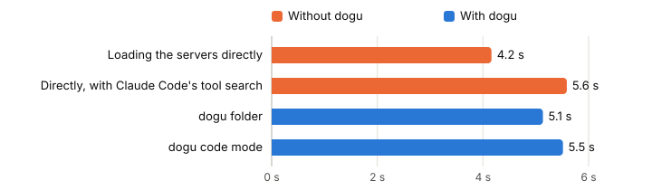
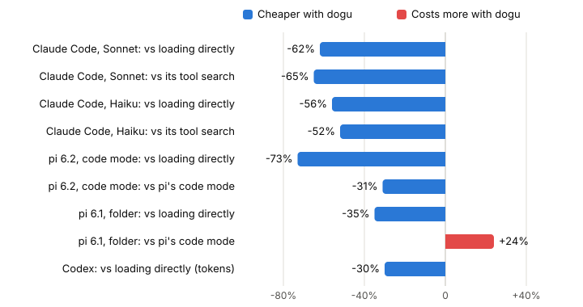
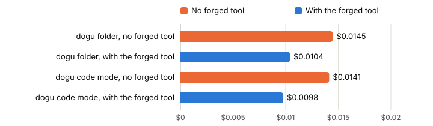

# dogu benchmarks, in plain words

AI coding agents like Claude Code, Codex and pi can use extra tools, such as "search GitHub" or "read this project's docs". The usual way to give them those tools makes the agent read a long description of every tool before every task, even tools it never uses. That reading costs money and time.

dogu gives the agent the same tools in a lighter way. We tested whether that is really cheaper and faster, with real agents doing real tasks, and checked every answer.

**The short version:**

- With Claude Code, tasks cost **about 60% less** with dogu, and the answers were just as right.
- dogu was also cheaper than Claude Code's own fix for this problem, "tool search", by about 65%.
- Loading the tools the usual way is still **about a second faster** on quick, one-step tasks.
- With Codex, dogu read 30% less and was faster, in normal and in fast mode.
- One agent's own feature (pi's "code mode") beat dogu on cost.

Every number below comes from the files in [`bench/results/`](bench/results/), and you can [run the tests yourself](#run-it-yourself).

## A few words first

| Word | What it means here |
|---|---|
| **Agent** | An AI that does tasks by itself, such as Claude Code, Codex or pi. |
| **Tool** | Something the agent can use, like "search GitHub repositories". Tools come from **MCP servers**. We used GitHub's own server, Context7 (library docs), DeepWiki (docs about code on GitHub) and a small local "memory" server. |
| **Tokens** | Pieces of text the AI reads. More tokens means more to read: more cost and usually more time. |
| **Cost** | What the agent's AI company charges for one task, in US dollars, at API prices. |
| **Loading the servers directly** | The usual way: the agent gets every tool's full description up front. |
| **dogu folder** | Each tool becomes a small command in a folder, and the agent gets one short line per tool. |
| **dogu code mode** | The agent writes a short program that calls the tools it needs. |

## 1. What a task costs

8 tasks, written down and saved **before** any test ran, so they could not be tweaked to make dogu look good. Each was done 3 times by Claude Code with the Sonnet model: 120 runs, and all 120 answers were right.


| Way of giving the agent its tools | Cost per task | Answers right |
|---|---|---|
| Loading the servers directly | $0.034 | 24 of 24 |
| Directly, with Claude Code's tool search | $0.037 | 24 of 24 |
| **dogu folder** | **$0.013** | 24 of 24 |
| **dogu code mode** | **$0.013** | 24 of 24 |

**Why is tool search more expensive, when it reads less?** AI companies give a big discount for text the agent has read before (this is called caching). dogu's tool list stays the same from task to task, so it gets that discount. Tool search adds tool descriptions in the middle of each task, and new text in the middle is charged at the full price.

## 2. How long a task takes



| Way of giving the agent its tools | Time per task (typical) |
|---|---|
| **Loading the servers directly** | **4.2 s** |
| Directly, with Claude Code's tool search | 5.6 s |
| dogu folder | 5.1 s |
| dogu code mode | 5.5 s |

Here dogu does **not** win. With every tool already described, the agent can act at once; with dogu it first looks up the one tool it needs. On quick tasks that extra step costs about a second.

## 3. Other agents

The same 8 tasks, with three agents. Each bar compares dogu's folder with that agent's usual way, and, where the agent has one, with its own fix for the same problem. Left of zero means dogu was cheaper; right means it cost more.



| Agent and model | Compared with | Change in cost with dogu |
|---|---|---|
| Claude Code, Sonnet | Loading directly | **62% less** |
| Claude Code, Sonnet | Its tool search | **65% less** |
| Claude Code, Haiku | Loading directly | **56% less** |
| Claude Code, Haiku | Its tool search | **52% less** |
| pi, gpt-6.1-sol | Loading directly | **35% less** |
| pi, gpt-6.1-sol | Its own code mode | **24% more** |
| Codex, its default model | Loading directly | 30% fewer tokens* |

\* Codex runs on a ChatGPT plan and does not report a price, so this one compares tokens. It uses the setting dogu's README asks Codex users to add (letting Codex's sandbox write `~/.npm`). An earlier run without that setting saved only 6%, because one of the tools could not start. Codex also did something worth knowing: with the tools loaded directly, it often skipped them and fetched web pages itself, in 4 of 16 runs. With dogu it did that once in 32.

pi's own code mode was built for exactly this problem, and in pi it is the cheaper choice. The dogu folder was the fastest of pi's three options.

## 4. Fast mode

Codex has a **fast mode**: OpenAI answers faster, and it uses more of your plan. We ran the same 8 tasks with it on and off.


| Codex | Normal speed | Fast mode | Answers right |
|---|---|---|---|
| Loading the servers directly | 13.8 s | 10.0 s | 32 of 32 |
| **dogu folder** | **11.2 s** | **9.2 s** | 32 of 32 |

Fast mode made tasks about a fifth to a quarter quicker, with the same answers, and dogu stayed the faster of the two in both modes. Whether that is worth the extra use of your plan is your call; Codex does not say how much more it uses, so we cannot put a number on it.

## 5. Saving a job as a new tool

When an agent works out a job that takes several steps, dogu lets it save the steps as a new tool, which we call **forging**. The next time, the job is one step.

We gave the same job five times in a row, with a different GitHub organization each time.



| | Without a forged tool | With the forged tool |
|---|---|---|
| dogu folder | $0.0145 per job, 9.0 s | **$0.0104 per job, 7.1 s** |
| dogu code mode | $0.0141 per job, 7.8 s | **$0.0098 per job, 7.1 s** |

Saving the tool costs a little once. It pays for itself after **3 more jobs** in code mode and **9** in the folder. Agents used their saved tool every time, 24 times out of 24.

We also tried letting a strong model (Sonnet) save the tool and a cheap model (Haiku) use it. Haiku used it every time and was faster, but Haiku was already cheap and could do the job alone, so the savings took 42 to 102 jobs to repay. It is not a good deal for easy jobs.

## 6. Where dogu does not win

- With Claude Code, on quick one-step tasks, **loading the tools directly is about a second faster**.
- In **pi**, pi's own code mode is cheaper than dogu's folder.
- With **Codex**, without the `~/.npm` setting the saving was small (6%), because a local tool could not start.
- An agent told only "read the README first", instead of having the tool list in its standing instructions, **costs more** than loading the tools directly, because it reads the long list in the middle of every task.

## How we kept it fair

- **The tasks were saved before any test ran** ([commit 7890a28](https://github.com/New1Direction/dogu/commit/7890a28)), and dogu was never adjusted for them. 5 earlier tasks, which dogu *was* tuned on, are reported separately.
- **Every answer is checked** against the real answer, fetched live just before the test (for example from GitHub). One task hides a made-up word that changes every run, so the answer cannot be guessed.
- **The checks are checked:** before any test, each check must accept the right answer and reject "I don't know."
- **The competitors' best features were included:** Claude Code's tool search and pi's code mode.
- **Each task ran 2 or 3 times**, and the files keep every single run, including the steps each agent took.
- **Caching was handled like real use:** the same project folder each time, a new conversation each time, and one warm-up first, so no way got an unfair head start.

## Run it yourself

You need Claude Code, the GitHub command line `gh` (both logged in), dogu and [Deno](https://deno.com). Then:

```
deno run --allow-run --allow-env --allow-read --allow-write --allow-net bench/run.ts
```

The full method, and how to choose agents, tasks and models, is in [`bench/README.md`](bench/README.md). The charts on this page are drawn from the result files by `bench/charts.ts`.
