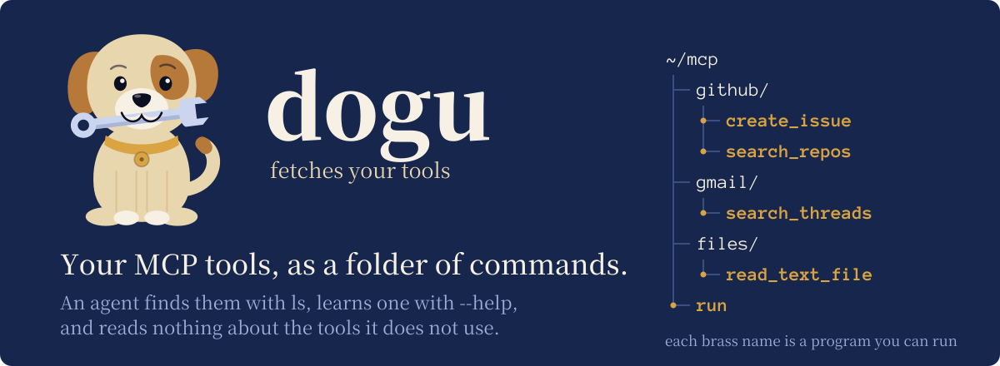
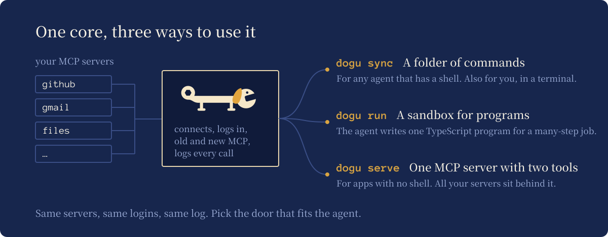

<p align="center">
  
</p>

<p align="center">
  <a href="https://github.com/New1Direction/dogu/actions/workflows/ci.yml"></a>
  <a href="https://github.com/New1Direction/dogu/releases/latest"></a>
  <a href="LICENSE"></a>
</p>

**Code mode and a local folder of commands, for every MCP tool you have.**

dogu turns each tool into a small program in a folder. An agent uses them the way it uses any other command: `ls` to find one, `--help` to learn it, a pipe to chain two. For a job with many calls, it writes one TypeScript program and dogu runs it in a sandbox.

Measured with GitHub, Context7 and DeepWiki connected: either way costs about half as much per task as loading the servers into the agent directly, and gets the same answers. [The benchmark](bench/) is in the repo.

```
curl -fsSL https://raw.githubusercontent.com/New1Direction/dogu/main/install.sh | sh
dogu sync
```

<p align="center">
  
</p>

<p align="center"><sub>Claude Code, told only where the folder is. Recorded live: each ▸ is a command it ran. <a href="assets/agent.tape">How this was made</a>.</sub></p>

## The problem

Connect an agent to MCP servers and every tool's full definition is loaded into its context before you say a word. With a few servers that is thousands of tokens spent on tools the agent will mostly never call. It costs money on every message, and the more tools there are, the worse the agent gets at picking the right one.

dogu keeps the tools on disk instead. The agent gets one line per tool, with its flags, and looks up the details only for the tool it uses.

Measured, not estimated, on [8 tasks written before any run and never tuned against](bench/): GitHub's official server, Context7, DeepWiki and a local memory server, 3 runs each, every answer checked. Claude Code on Sonnet, 120 runs, all right:

| | Read before starting | Read in total | Cost per task | Time |
|---|---|---|---|---|
| The servers loaded directly | 29.0k tokens | 59.1k | $0.034 | **4.2s** |
| The same, with Claude Code's tool search on | 7.0k | 23.6k | $0.037 | 5.6s |
| dogu folder, tool list in the agent's instructions | 12.1k | 25.1k | **$0.013** | 5.1s |
| dogu code mode (`dogu serve`) | **4.3k** | **15.0k** | **$0.013** | 5.5s |

On Haiku the order is the same: dogu costs 56 to 60% less than both. Loading the servers directly is about a second faster on these short tasks, because it needs no step to find a tool. Tool search reads fewer tokens than loading everything, but costs more, because it brings tool definitions in mid-session, and those are cached at the higher write price.

### Other agents

The gap depends on the agent:

- **Codex** (its default model): the dogu folder in `AGENTS.md` read 6% fewer tokens at the same speed as Codex with the servers loaded directly. Codex's own instructions are large, so tool definitions are a smaller share. With the servers loaded directly, Codex went around them with `curl` in 6 of 16 runs; with the folder, never.
- **pi** (gpt-6.1-sol): the dogu folder was 35% cheaper and 15% faster than pi with the tools declared directly. pi has its own code mode, built for the same problem, and it was cheaper still: the folder cost 24% more, and was 21% faster.

All results, and how to run them yourself: [`bench/`](bench/).

## What you get

- **A smaller context.** The agent reads about the tools it uses and no others.
- **Room for hundreds of tools.** A tool nobody calls costs nothing.
- **Big results stay out of the chat.** Send a result to a file or through `jq` and `head`. The agent sees only what it needs.
- **Tools chain.** The output of one goes into the next without passing through the model.
- **You can use them too.** They are normal commands. Run them in a terminal, a script or a cron job.
- **A sandbox for many-step jobs.** The agent writes one TypeScript program, and dogu runs it with no access to your files or network.

## Install

On macOS or Linux:

```
curl -fsSL https://raw.githubusercontent.com/New1Direction/dogu/main/install.sh | sh
```

It downloads the build for your machine from the latest release, checks its SHA-256, and puts `dogu` in `~/.local/bin`. Set `DOGU_INSTALL_DIR` to put it somewhere else.

Or build it with [Rust](https://rustup.rs):

```
cargo install --git https://github.com/New1Direction/dogu
```

Then:

```
dogu sync
```

`dogu sync` reads the MCP config you already have, asks each server for its tools, and writes them to `~/mcp`. It looks for a config in this order:

1. `--config <file>`
2. `$DOGU_CONFIG`
3. `./.mcp.json`, then `./mcp.json`
4. `~/.config/dogu/mcp.json`
5. Claude Code's `~/.claude.json`: your servers, plus the ones added for the folder you run `dogu sync` in
6. The Claude Desktop config
7. `~/.cursor/mcp.json`

It takes the first one that lists any servers.

Then tell your agent where the tools are. The fastest and cheapest way is to put the folder's README, which lists every tool, in its standing instructions. In Claude Code's `CLAUDE.md`:

> @~/mcp/README.md

For any other agent, one line in `AGENTS.md` or a system prompt works too, at the cost of one extra step per task:

> Your tools are in ~/mcp. Read ~/mcp/README.md first.

Or let agents find it on their own: the folder is also an [Agent Skill](https://agentskills.io). `dogu sync --link-skill` links it into `~/.claude/skills` and `~/.agents/skills`, where Claude Code, Codex, pi and others look.

**Codex users:** Codex's sandbox blocks `~/.npm`, so local servers that start with `npx` cannot run inside it. Allow it in `~/.codex/config.toml`:

```toml
[sandbox_workspace_write]
writable_roots = ["/Users/you/.npm"]
```

Run `dogu sync` again when your servers change. It reads the same config as the first time. To switch, pass `--config`.

## What the folder looks like

For example, with GitHub and a filesystem server connected:

```
~/mcp/
  README.md            how to use the folder. The agent reads this first.
  run                  runs a TypeScript program in the sandbox
  github/
    README.md          the tools, one line each
    create_issue       a program. --help shows its parameters.
    search_repos
    index.d.ts         the same tools as TypeScript types
  files/
    read_text_file
    ...
```

## Use a tool

<p align="center">
  
</p>

```sh
github/create_issue --help                                  # parameters, from a saved copy. No network.
github/create_issue --repo me/app --title "Bug"             # flags
github/create_issue '{"repo": "me/app", "title": "Bug"}'    # JSON
cat issue.json | github/create_issue -                      # JSON from a pipe
files/read_multiple_files --paths a.txt --paths b.txt       # repeat a flag for a list
github/search_repos --query rust | jq '.items[].name' | head
```

- Results print to stdout. Errors print to stderr with exit code 1.
- A missing parameter, a typo in a flag or a wrong type is caught before the server is called, with a message that says what to fix.
- Images and audio are saved to a temp file, and the path is printed.
- `--json` prints the result as one line of JSON, so `jq` always works. The README shows the fields each tool returns, like `→ {tag_name, html_url, …}`.
- `--raw` prints the server's full JSON answer.

## Three ways to use it

<p align="center">
  
</p>

### 1. A folder of commands

This is everything above. It works with any agent that can run shell commands, and it needs nothing else installed.

### 2. A sandbox for programs

When a job needs many calls, a loop, or filtering of big results, the agent writes one TypeScript program:

```sh
~/mcp/run - <<'EOF'
const issues = await tools.github.search_issues({ query: "is:open label:bug" });
const quiet = issues.filter((i) => i.comments === 0);
console.log(quiet.length, "open bugs with no reply");
EOF
```

- `tools.<app>.<tool>({...})` returns a Promise. A failed call throws an Error.
- The result is the tool's structured data if it has any, else parsed JSON, else text.
- In code, `-` and `.` in names become `_`: the tool `get-sum` is `tools.app.get_sum`.
- Each app folder has an `index.d.ts`. The agent reads it before it writes.
- Calls to one server reuse one connection, so only the first is slow.

This needs [Deno](https://deno.com) (`brew install deno`). Deno is the sandbox.

| Limit | Default | Change with |
|---|---|---|
| Which tools the program may call | all | `--allow github --allow 'files/read_*'` |
| Run time | 120 seconds | `--timeout 30` or `DOGU_TIMEOUT` |
| Memory | 256 MB | `DOGU_MEMORY_MB` |
| Printed output | 1 MB | `DOGU_MAX_OUTPUT` |

### 3. One MCP server with three tools

Some apps have no shell, such as Claude Desktop. For those, `dogu serve` is an MCP server with three tools: `search` finds tools and returns their types, `run_code` runs a program in the sandbox, and `forge` saves a program as a new tool. All your other servers sit behind those three.

1. Move your real servers into `~/.config/dogu/mcp.json`.
2. Run `dogu sync --config ~/.config/dogu/mcp.json`.
3. In the app's own config, keep only this:

```json
{ "mcpServers": { "tools": { "command": "dogu", "args": ["serve"] } } }
```

## Make your own tools

When an agent has worked out a job that takes several calls, it can save its program as a new tool, and the next session does the job in one call:

```sh
~/mcp/forge latest_releases program.ts     # or the `forge` tool in code mode
~/mcp/forged/latest_releases --org tokio-rs
```

The program starts with a short header:

```ts
// @description Latest release of each of an org's 3 most-starred repos.
// @param org string required The GitHub org
const top = await tools.github.search_repositories({ query: `org:${args.org}`, sort: "stars", perPage: 3 });
// ...
console.log(JSON.stringify(result));
```

A forged tool works like any other: `--help`, a line in the README, `tools.forged.<name>()` in a program. It runs in the sandbox and may only call the tools its code names. It survives `dogu sync`.

Measured over a job repeated for five GitHub orgs, on Sonnet: once the tool exists, each job costs 28 to 31% less, is faster, and in the folder takes 2 turns instead of 3. Forging pays for itself after 3 more jobs in code mode and 9 in the folder (the session after forging refreshes the prompt cache once). Agents used their forged tool in every later session, 24 of 24.

## Logging in to remote servers

Many hosted servers want an OAuth login. If `dogu sync` says a server needs one:

```
dogu login
dogu sync
```

- `dogu login` opens your browser for each server that needs it. `dogu login <server>` does one. `dogu logout <server>` forgets it.
- Logins are saved in `~/.config/dogu/auth.json`, which only you can read. Tokens are refreshed when they expire.
- A tool never opens a browser by itself. If a login has run out, the tool fails and says `Run: dogu login <server>`.
- On a machine with no browser, set `DOGU_NO_BROWSER=1` and open the printed link somewhere else. The link comes back to `127.0.0.1:38573` on the machine that runs dogu, so forward that port: `ssh -L 38573:127.0.0.1:38573 ...`

<details>
<summary>How dogu gets a client ID</summary>

In this order:

1. From your config, if you registered an app with the service yourself: `"oauth": { "client_id": "...", "client_secret": "..." }` next to the `"url"`.
2. From a Client ID Metadata Document, if you host one. Put `client-metadata.json` from this repo on an HTTPS URL you own, fix the URLs inside it, and set `DOGU_CLIENT_ID_URL` to that URL. The current MCP spec prefers this way.
3. By registering itself with the service (Dynamic Client Registration). This needs no setup and is the default, but the spec has deprecated it.

</details>

## What the sandbox protects, and what it does not

A program run by `dogu run` or `run_code` has every Deno permission switched off. `tests/escape.ts` tries 17 ways out. All 17 are blocked:

| Blocked | |
|---|---|
| Reading or writing files | `Deno.readTextFile`, `node:fs`, `fetch("file://...")` |
| The network | `fetch`, `WebSocket`, importing from a URL, `npm:` and `jsr:` imports |
| Your environment | `Deno.env`, `process.env`, the hostname |
| Other programs | `Deno.Command`, `node:child_process`, FFI |
| Importing local files | static and dynamic `import` of any file on disk |

The limits of that protection:

- **It does not make your tools safe.** If a tool can delete files or send email, a program can call it. Use `--allow` to give a program only the tools the job needs.
- **It only matters if the agent has no other way out.** An agent with a shell can skip the sandbox. For the full benefit, give the agent `dogu serve` and no shell.
- **It is Deno's permission system, not a virtual machine.** Deno maintains it as a security boundary, but a bug in Deno would be a bug here.

Every tool call is recorded in `~/mcp/.dogu/log.jsonl`: the time, the tool, whether it worked, how long it took. Parameters and results are not recorded.

## Protocol support

MCP changed shape in its 2026-07-28 release: the `initialize` handshake and sessions are gone, and every request says which version it speaks. dogu speaks both the new protocol and the older one. It tries the new one first, falls back, and remembers the answer for each server.

Transports: stdio and Streamable HTTP.

## Tested

- **The official MCP conformance suite**, `@modelcontextprotocol/conformance`. 35 client scenarios pass: 8 for the protocol and the 27 core OAuth ones (discovery, PKCE, scopes, step-up, issuer checks, token endpoint auth, registration). Run them with `sh tests/conformance.sh`.
- **The sandbox escape test**, `tests/escape.ts`.
- **Real servers**: the official filesystem, memory and everything servers, a server built with the v2 TypeScript SDK, the SDK's OAuth demo server, and these hosted ones: GitHub's official server (with a token), Linear (with `dogu login`, including token refresh), Context7 and DeepWiki.
- **A real agent**: Claude Code, told only "Your tools are in ~/mcp. Read ~/mcp/README.md first.", used the folder for a three-step job with no errors, and did the same through `dogu serve` with no shell.
- **A benchmark** (`bench/`, written with [Effect](https://effect.website)): Claude Code, Codex and pi, each with the servers loaded directly and through dogu, on tasks written before any run, with every answer checked. Over 400 runs. Results are in `bench/results/`.

## Status

This is version 0.4.0 and it is new. Here is what has not been done yet:

- It has been built and run on **Linux and macOS**. Windows does not work: the tools are `sh` scripts.
- Of the **hosted servers**, GitHub, Linear, Context7 and DeepWiki have been tried. Notion and others have not. Real services have quirks. If one breaks, please open an issue with the output of `DOGU_DEBUG=1 dogu sync`.
- **Tools that ask the user a question mid-call** (elicitation, sampling) are not supported. The call fails with a clear message.
- **Resources and prompts** are not exposed. Tools only.
- **Inside Codex's sandbox, local `npx` servers need `~/.npm` writable** (see above). When a local server dies at start, dogu shows what it said.
- **Each command starts its server, runs the tool and stops it.** A server started with `npx` takes a second or more per call. `dogu serve`, and a program run with `dogu run`, keep connections open.
- **Types are stripped, not checked**, before a program runs. A wrong parameter shows up as an error from the tool.
- **The old SSE transport** from 2024 is not supported.

## Questions

**Is this a real filesystem mount?**
No. It is a normal folder of small scripts that `dogu sync` writes. A real mount needs FUSE, which is painful to install on macOS and different again on Windows. A mount also makes reading a file run a tool, so `grep -r` or a file indexer would call your tools by accident.

**Which agents does it work with?**
The folder works with any agent that can run shell commands. `dogu serve` works with any app that can connect to an MCP server.

**Is this "code mode"?**
Yes, in two forms. In the sandbox and in `dogu serve`, the agent writes TypeScript that calls tools. In the folder, it writes shell: each tool is a command, and pipes carry results from one tool to the next. Either way, results flow between tools without passing through the model, and it all runs on your machine with nothing to install but dogu.

**Do I have to change my MCP servers?**
No. dogu is a client. It reads the config you already have.

**Where does the name come from?**
"Dogu" is Japanese for "tools". It also has a dog in it, and the dog fetches them.

## Configuration

The usual `mcp.json`:

```json
{
  "mcpServers": {
    "files":  { "command": "npx", "args": ["-y", "@modelcontextprotocol/server-filesystem", "/Users/me/Documents"] },
    "remote": { "url": "https://example.com/mcp", "headers": { "Authorization": "Bearer ${MY_TOKEN}" } }
  }
}
```

- `${NAME}` is replaced with that environment variable, so secrets can stay out of the file.
- A local server runs in the folder the config file is in, unless it has a `"cwd"`.
- A remote server with no `Authorization` header uses the login flow when the server asks for one.

| Variable | What it does |
|---|---|
| `DOGU_CONFIG` | Path to the config file |
| `DOGU_TIMEOUT` | Seconds to wait: 300 for one tool, 120 for a whole program |
| `DOGU_MEMORY_MB` | Memory limit for a program. Default 256 |
| `DOGU_MAX_OUTPUT` | Most bytes a program may print. Default 1000000 |
| `DOGU_CALLBACK_PORT` | Port the browser comes back to after a login. Default 38573 |
| `DOGU_CLIENT_ID_URL` | URL of your hosted client metadata document |
| `DOGU_NO_BROWSER` | Print the login link and do not open a browser |
| `DOGU_DEBUG` | Show what local servers print, and more detail on failures |

## How it is built

About 3,400 lines of Rust and JavaScript, with five dependencies and no async runtime.

| File | Job |
|---|---|
| `src/config.rs` | Read `mcp.json` |
| `src/client.rs` | Talk MCP over stdio or HTTP, in both protocol eras |
| `src/auth.rs` | OAuth login: discovery, the browser round trip, tokens, refresh |
| `src/sync.rs` | Write the folder: the commands, the READMEs, the TypeScript types |
| `src/call.rs` | Run one tool from the command line |
| `src/run.rs` | Start the sandbox and answer the program's tool calls |
| `src/runner.js` | The only trusted code inside the sandbox |
| `src/serve.rs` | Be an MCP server with `search` and `run_code` |

## Roadmap

1. Keep local servers running between commands, so `npx` servers are fast in the folder too.
2. Resources as plain read-only files in each app's folder.
3. A Homebrew formula.
4. Windows.
5. Exploring: run programs without installing Deno, with an embedded JavaScript engine.

Issues and pull requests are welcome. The most useful report right now is "I ran it against server X and this happened".

## License

MIT. See [LICENSE](LICENSE).
